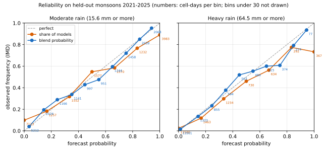

# Blending and bust detection: how far to trust each rain forecast

Generated by `python -m models.blend --report docs/blend.md`. Do not edit by hand.

## Result

- **Busts by trust, held-out monsoons 2021-2025.** A bust (forecast and IMD two or more rain classes apart) happened on 2.8% of high-trust cell-days, 2.4% of medium and 4.7% of low. Low trust covers 15% of cell-days and holds 133 of the 540 busts. The 90% ranges of high and low overlap, so overall this is a weak signal. Low trust busted more often than high in 3 of 5 years.
- **Heavy-rain forecasts.** When the blend forecast heavy rain, it busted on 4% (43 of 1103) high-trust cell-days, 9% (54 of 587) medium and 17% (30 of 181) low. These are the forecasts an alert would rest on.
- **Forward check** (fit on 2021-2024, test 2025 only): bust rate 2.6% high, 2.4% medium, 3.4% low.
- **Blend against Stage 4's way** (one quantile map on the plain mean), same held-out years: MAE 13.5 against 13.7 mm, heavy-rain CSI 0.42 against 0.44, moderate CSI 0.63 against 0.63. Mixed, within the ranges, so flood risk keeps Stage 4's rain amount.
- **Probabilities** (reliability plot below). Brier skill against climatology, heavy rain: 0.39 for the blend probability, 0.33 for the plain share of models above 64.5 mm. At the top, heavy rain followed 94% of the 77 blend forecasts in 0.9-1.0 and 73% of the 367 share-of-models forecasts in 0.9-1.0.
- **Low-trust cases flagged:** 11 days of 2025 had at least half the cells at low trust; they are listed below. Risk runs now carry this trust per ward (map and API), and the API names the low-trust wards in its warnings.
- **Heat.** The spread of the three heat forecasts does not grade them: the level was missed more often at high trust (20% high, 12% medium, 9% low, 2025). Heat runs keep their fixed medium trust until a measure that works is found.

## Setup

- **Forecasts:** Open-Meteo's archive of stitched short-lead forecasts (about a day ahead), June-September, at the 30 pilot grid cells. Models present each year are in the per-year table; ECMWF is IFS 0.4 degree until February 2024 and IFS 0.25 degree after.
- **Truth:** IMD gridded daily rain, the 24 hours ending 08:30 IST.
- **Blend:** each model quantile-mapped to IMD on its own (training years where it exists), then the corrected models present averaged with weights 1 / MAE.
- **Probability:** logistic regression of the event (IMD at or above 15.6 or 64.5 mm) on the share of corrected models at or above it and log(1 + blend).
- **Trust:** spread (standard deviation) of log(1 + corrected rain) across the models present. High below the 50th percentile of the training years' wet cell-days (any model at 2.5 mm or more), low above the 85th, medium between; every model dry = high; fewer than two models = low. Final limits: 0.55 and 0.83.
- **Bust:** forecast and IMD two or more classes apart (dry < 2.5, rain < 15.6, moderate < 64.5, heavy < 115.6 mm, very heavy).
- **Split:** leave one year out; each monsoon is scored by a fit on the other four, so no forecast is scored by a fit that saw its season. Neighbouring cells share IMD values and weather, so the cell-days are far from independent; the 90% ranges resample whole days.
- **Saved model** (`processed/models/blend.json`): fitted on all of 2021-2025; blend weights ECMWF 0.17, GFS 0.17, ICON 0.18, JMA 0.17, UKMO 0.15, GEM 0.15.

## Busts by trust (held-out years)

| Trust | Cell-days | Share | MAE (mm) | Busts | Bust rate | 90% range | Heavy rain seen | Heavy rain missed |
| --- | --- | --- | --- | --- | --- | --- | --- | --- |
| high | 9376 | 51% | 13.5 | 261 | 2.8% | 2.0% to 3.8% | 1238 | 507 |
| medium | 6108 | 33% | 13.6 | 146 | 2.4% | 1.7% to 3.1% | 650 | 304 |
| low | 2816 | 15% | 13.0 | 133 | 4.7% | 2.8% to 6.9% | 154 | 66 |

### Bust rate by trust within each forecast amount

Big forecasts disagree more and bust more, so trust could just repeat the amount. Within each class of blended rain, the bust rate should still rise from high to low trust.

| Blended forecast | High | Medium | Low |
| --- | --- | --- | --- |
| dry | 1% (34 of 2524) | 1% (9 of 609) | 8% (6 of 73) |
| rain | 1% (27 of 2807) | 0% (4 of 2516) | 0% (3 of 1376) |
| moderate | 5% (157 of 2942) | 3% (79 of 2396) | 8% (94 of 1186) |
| heavy or more | 4% (43 of 1103) | 9% (54 of 587) | 17% (30 of 181) |

### By year

Bust rate by trust level, with the models the archive has that year.

| Year | Days | Models | High | Medium | Low |
| --- | --- | --- | --- | --- | --- |
| 2021 | 122 | GFS, JMA | 4% (133 of 3056) | 3% (11 of 409) | 2% (4 of 195) |
| 2022 | 122 | GFS, JMA, UKMO | 2% (37 of 2245) | 4% (31 of 814) | 8% (49 of 601) |
| 2023 | 122 | ECMWF, GFS, ICON, JMA, UKMO, GEM | 2% (22 of 1369) | 2% (32 of 1597) | 0% (2 of 694) |
| 2024 | 122 | ECMWF, GFS, ICON, JMA, UKMO, GEM | 2% (37 of 1480) | 2% (28 of 1434) | 8% (58 of 746) |
| 2025 | 122 | ECMWF, GFS, ICON, JMA, UKMO, GEM | 3% (32 of 1226) | 2% (44 of 1854) | 3% (20 of 580) |

## Reliability

A point on the diagonal means that when the forecast says p, the event happens a fraction p of the time. Points below it are overconfident.

### Moderate rain (15.6 mm or more)

Brier score: blend probability 0.134 (skill 0.45), share of models 0.146 (skill 0.40). Skill is against the training years' frequency of the event; 0 = no better, 1 = perfect.

| Probability bin | Share of models: cases | observed | Blend: cases | observed |
| --- | --- | --- | --- | --- |
| 0.0-0.1 | 7113 | 0.10 | 5212 | 0.04 |
| 0.1-0.2 | 1257 | 0.18 | 2024 | 0.19 |
| 0.2-0.3 | 10 | 0.10 | 1166 | 0.29 |
| 0.3-0.4 | 1552 | 0.32 | 1141 | 0.34 |
| 0.4-0.5 | 6 | 0.00 | 997 | 0.43 |
| 0.5-0.6 | 1577 | 0.55 | 951 | 0.48 |
| 0.6-0.7 | 1570 | 0.58 | 1244 | 0.59 |
| 0.7-0.8 | - | - | 1458 | 0.72 |
| 0.8-0.9 | 1232 | 0.77 | 2039 | 0.85 |
| 0.9-1.0 | 3983 | 0.89 | 2068 | 0.95 |

### Heavy rain (64.5 mm or more)

Brier score: blend probability 0.061 (skill 0.39), share of models 0.067 (skill 0.33). Skill is against the training years' frequency of the event; 0 = no better, 1 = perfect.

| Probability bin | Share of models: cases | observed | Blend: cases | observed |
| --- | --- | --- | --- | --- |
| 0.0-0.1 | 13580 | 0.02 | 13501 | 0.02 |
| 0.1-0.2 | 1463 | 0.12 | 1323 | 0.13 |
| 0.2-0.3 | - | - | 855 | 0.23 |
| 0.3-0.4 | 1234 | 0.30 | 594 | 0.38 |
| 0.4-0.5 | - | - | 503 | 0.52 |
| 0.5-0.6 | 730 | 0.46 | 484 | 0.55 |
| 0.6-0.7 | 634 | 0.56 | 315 | 0.60 |
| 0.7-0.8 | - | - | 374 | 0.61 |
| 0.8-0.9 | 292 | 0.77 | 274 | 0.79 |
| 0.9-1.0 | 367 | 0.73 | 77 | 0.94 |

## Blend against simpler combinations (held-out years)

| Method | MAE (mm) | Moderate CSI | Moderate 90% range | Heavy CSI | Heavy 90% range | Heavy bias | Bust rate |
| --- | --- | --- | --- | --- | --- | --- | --- |
| plain mean of the models present, uncorrected | 13.6 | 0.63 | 0.60 to 0.66 | 0.17 | 0.12 to 0.23 | 0.21 | 3.3% |
| one quantile map on the plain mean (Stage 4's way) | 13.7 | 0.63 | 0.60 to 0.66 | 0.44 | 0.38 to 0.50 | 1.01 | 3.4% |
| blend: each model mapped, weighted by skill (Stage 11) | 13.5 | 0.63 | 0.60 to 0.66 | 0.42 | 0.36 to 0.48 | 0.92 | 3.0% |

Forward check, 2025 only (fit on 2021-2024):

| Method | MAE (mm) | Moderate CSI | Heavy CSI | Bust rate |
| --- | --- | --- | --- | --- |
| plain mean of the models present, uncorrected | 12.2 | 0.59 | 0.32 | 1.3% |
| one quantile map on the plain mean (Stage 4's way) | 13.3 | 0.59 | 0.48 | 2.8% |
| blend: each model mapped, weighted by skill (Stage 11) | 14.3 | 0.58 | 0.49 | 2.6% |

## Low-trust days in 2025

Days with at least half the pilot cells at low trust. Rain is the city mean in mm for the 24 hours ending 08:30 IST; each model's amount is after its correction.

| Date | Cells at low trust | Models (corrected) | Blend | IMD | Cells busted |
| --- | --- | --- | --- | --- | --- |
| 2025-06-02 | 60% | ECMWF 9, GFS 10, ICON 4, JMA 0, UKMO 8, GEM 3 | 6 | 5 | 0 of 30 |
| 2025-06-04 | 80% | ECMWF 14, GFS 3, ICON 13, JMA 2, UKMO 43, GEM 4 | 13 | 21 | 0 of 30 |
| 2025-06-05 | 63% | ECMWF 9, GFS 3, ICON 5, JMA 1, UKMO 27, GEM 4 | 8 | 20 | 0 of 30 |
| 2025-06-08 | 90% | ECMWF 12, GFS 1, ICON 15, JMA 3, UKMO 21, GEM 7 | 10 | 26 | 0 of 30 |
| 2025-06-12 | 97% | ECMWF 3, GFS 2, ICON 0, JMA 13, UKMO 0, GEM 0 | 3 | 1 | 0 of 30 |
| 2025-06-25 | 63% | ECMWF 27, GFS 58, ICON 77, JMA 68, UKMO 16, GEM 39 | 49 | 7 | 4 of 30 |
| 2025-06-30 | 67% | ECMWF 20, GFS 32, ICON 64, JMA 35, UKMO 5, GEM 16 | 30 | 7 | 0 of 30 |
| 2025-07-08 | 90% | ECMWF 16, GFS 15, ICON 21, JMA 62, UKMO 3, GEM 29 | 24 | 9 | 0 of 30 |
| 2025-08-13 | 60% | ECMWF 8, GFS 3, ICON 16, JMA 10, UKMO 19, GEM 1 | 10 | 7 | 0 of 30 |
| 2025-08-29 | 53% | ECMWF 27, GFS 26, ICON 46, JMA 32, UKMO 85, GEM 7 | 37 | 22 | 0 of 30 |
| 2025-09-27 | 53% | ECMWF 13, GFS 5, ICON 16, JMA 14, UKMO 31, GEM 92 | 27 | 23 | 0 of 30 |

## Heat: trust from the three models' spread

Spread = range of the three corrected apparent-temperature forecasts. Limits from the heat model's fitting period (2024-02-01 to 2024-12-31): high below 1.74 °C, low from 2.81 °C. Scored on 2025 per ERA5 cell-day; a level miss is a forecast level (green, yellow, orange, red) different from ERA5's.

| Trust | Cell-days | MAE (°C) | Level missed |
| --- | --- | --- | --- |
| high | 163 | 0.85 | 20% |
| medium | 294 | 0.96 | 12% |
| low | 273 | 0.93 | 9% |

## Limits

- About a day ahead only: the archive stitches short-lead forecasts. Disagreement grows with lead time; the limits here were not learned on longer leads (the Stage 7 replays apply them unchanged to forecasts made 1-3 days ahead with three models).
- The model set changes over the years (two models in 2021, six from 2023), and the spread of two models is a noisier measure than the spread of six. Live runs fetch all six. With only ECMWF, GFS and ICON (forecast files fetched before Stage 11, and the Stage 7 replays) the spread is smaller, so fewer cells come out low.
- IMD is itself a 0.25 degree interpolation of rain gauges, so part of a 'bust' at one cell can be IMD missing a downpour between gauges.
- Trust is about the rain forecast. The flood model's own weakness (Stage 5: unreviewed labels, warns too often) is shown on the map as a separate caveat.

## Next

- Learn the limits by lead time from the Previous Runs archive (2024 onwards).
- Use trust in the Stage 13 alert rules: no red alert on low trust without operator review.
